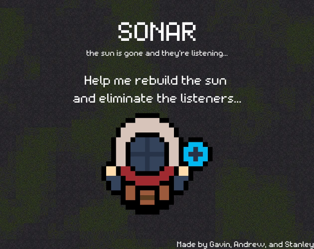

<h1 align="center">
Sonar
</h1>

<h2 align="center">
What is Sonar?
</h2>

OHH NOO! The SUN has EXPLODED!!! Darkness has filled the world. FIND the 3 Scattered Shards across the map and rebuild The SUN. COLLECT food to survive and COLLECT FUEL to light up your base before the light is GONE FOREVER!!! Send sonar blasts to see in this world of DARKNESS

<h2 align="center">
Game Guide and Controls
</h2>

- WASD: controls direction
- E: places shards / fuels 
- Left click: shoots sonar / eats food
- 1-5: Choose position of tool bar
- Tab: Small inventory
- Shift: Sprint
- R: Reset
- GAME GUIDE: Travel across the map shooting sonar rays to light up the path ahead of you. Keep in mind, to collect fuel and shard artifacts as you go. Sonar rays will be able to bounce off walls and light up surrounding areas even further! Remember to place fuel artifacts inside the hopper at your base so that your light wont vanish forever. If your ever low on health, make sure to eat some of the food you collected. However, BEWARE of the listeners that lurk the shadows of this new world. 3 shards is all it takes to bring back THE SUN.
<h2 align="center">
Team
</h2>

- Gavin - Lead Programmer
- Andrew - Graphics Engineer, Sound Engineer
- Stanley - Graphics Engineer, Sound Engineer

<h2 align="center">
Credits
</h2>

Thank you to Haven San Francisco for hosting this Game Jam and allowing us to create this amazing game.

